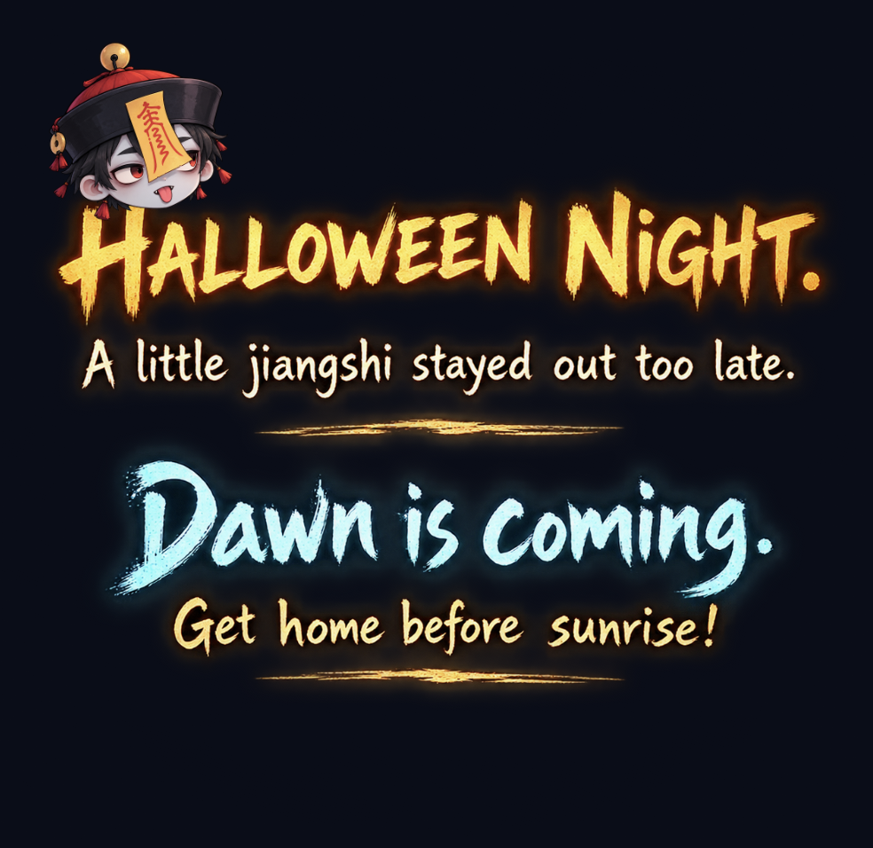

# 🧟 Jiangshi: Race Against Sunrise

**A playable Halloween climbing mini-game inspired by Chinese folklore and rock climbing.**

What happens when a Chinese *jiangshi* (hopping vampire) stays out too late on Halloween?

The sun is coming up. ☀️ To survive, the jiangshi must climb a cliff and reach shelter before sunrise.

Built for the **Rive Halloween Challenge 2026**.

## 🎮 Play the Game

🎬 **[Watch the Demo & View Challenge Entry]([https://on.contra.com/jd6NtP](https://on.contra.com/jd6NtP))**

🎮 **[Play Jiangshi: Race Against Sunrise](https://unique-tanuki-2d7f20.netlify.app/)**

## 🧗 Gameplay

Instead of moving a character with traditional platformer controls, players guide the jiangshi up the cliff by controlling its limbs individually.

- **Limb-by-limb climbing:** Select a hand or foot, then move it to a reachable climbing hold.
- **Dynamic moves (dynos):** Make bigger moves to reach distant holds.
- **Randomized routes:** Encounter different climbing routes across playthroughs.
- **Interactive feedback:** Visual cues support hold selection and movement.
- **A story-driven ending:** Reach the top and discover where the jiangshi hides from daylight.
- **Sound design:** Ambient audio and action-specific effects bring the climb to life.

## 🛠️ Built With

| Technology | Role |
| --- | --- |
| **Rive CLI** | Developing, previewing, and building the project |
| **Rive Markup Language (RML)** | Defining the scene |
| **Luau** | Gameplay and interaction logic |
| **Rive Data Binding** | Connecting game state to the interactive scene |
| **Rive Editor** | Inspecting and refining the experience |
| **Rive Web Runtime (WebGL2)** | Running the game in a browser |
| **Netlify** | Hosting the playable web version |

## 💡 Inspiration

I enjoy rock climbing, and I wanted to translate part of that experience into a small interactive game.

Combining climbing with the Chinese jiangshi and a Halloween sunrise deadline led to a simple premise: **get to the top before daylight catches you**.

The goal was not just to animate a character, but to build something people could actually play—from the first move to the final scene.

## 🎃 Rive Halloween Challenge

Created for the **2026 Rive Halloween Challenge**, using Rive CLI, RML, Luau scripting, and Data Binding.

## 🔗 Live Demo

https://unique-tanuki-2d7f20.netlify.app/
